**Author:** David Gao  **Course:** CSE 163, Autumn 2026

**GitHub repository:** <https://github.com/David-Gao-uw/ev-equity-project>

## 1. Summary of Research Questions

1. Across Washington ZIP codes, is EV ownership per 1,000 tax returns monotonically associated with average adjusted gross income (AGI) per return, and how large is the gradient across income quartiles?
2. Do used EVs reach lower-income ZIP codes than new ones — that is, among changes of ownership (title transactions), does the new-versus-used mix depend on the income quartile of the owner's ZIP code?
3. How is annual growth in new EV registrations distributed across Washington's 39 counties from 2010 to 2025, and does King County's share of statewide registrations decline over time?
4. Among used EV sales with a market price and a researched electric range, how does sale price vary with rated range, and does that slope differ significantly above versus below the 30-mile threshold set by 2019 HB 2042?

## 2. Motivation

Washington forgoes revenue each year through EV tax exemptions, and a tax expenditure is a distributive choice: it matters who receives it. Those exemptions are capped by vehicle price, which steers the benefit toward buyers of higher-priced cars, and the practical prerequisites for owning an EV — charging access, home ownership — are themselves unevenly distributed. Whether the subsidy is regressive is an empirical question answerable from registration and income records. The answer has a forward-looking half: if the used market moves EVs from high-income to lower-income ZIP codes, the equity picture of the subsidy today differs from the equity picture of electrification over time. Measuring where adoption lands, and through which market channel, is what makes incentive design possible.

## 3. Datasets

All three are public, download as direct CSV links, and need no login or key. The figures describe the snapshot downloaded on **18 November 2026**. The DOL files are refreshed monthly, so `src/download.py` records this snapshot's size and row count and warns when a later download differs.

**D1 — WA Dept. of Licensing, Electric Vehicle Population Data.** One row per currently registered EV: 304,258 rows and 16 columns, of which 11 are used. <https://data.wa.gov/api/views/f6w7-q2d2/rows.csv?accessType=DOWNLOAD>

**D2 — WA Dept. of Licensing, EV Title and Registration Activity.** One row per title or registration event: 1,964,093 rows and 33 columns, of which 13 are used. Since the proposal the row count grew 2.0% but the file grew from 258 MB to 952 MB, because each row is about 3.6 times wider. <https://data.wa.gov/api/views/rpr4-cgyd/rows.csv?accessType=DOWNLOAD>

**D3 — IRS Statistics of Income, ZIP Code Data (TY2022).** One row per ZIP and AGI bracket: 166,131 rows and 165 columns nationally, of which 6 are used. <https://www.irs.gov/pub/irs-soi/22zpallagi.csv>

## 4. Method

**EDA steps.** `src/data.py` loads each file with an explicit column list, reading Postal Code as text so leading zeros survive. It normalises ZIPs to five digits, and anything that is not a real ZIP — including the IRS pseudo-codes `00000` (state total) and `99999` (small ZIPs) — becomes `NA`, so no join can match on it. `src/eda_report.py` measures missingness, profiles each dataset and each join (seven-number summaries, complete value counts, two plots each), checks test assumptions, and writes every number quoted here to `notes/eda_stats.json`.

**Planned analysis** (updated from the proposal; tests and their assumptions are detailed in §6.7):

- **RQ1:** EVs per 1,000 returns per ZIP (D1 × D3), with Spearman's ρ, a within-region permutation test, a bootstrap interval, and quartile medians.
- **RQ2:** new versus used *title events* per income quartile (D2 × D3), with a chi-square test and Cramér's V.
- **RQ3:** new-vehicle original titles by year and county (D2), with year-over-year growth from 2012, a three-year trailing mean, and King County's share. Partial 2026 is excluded.
- **RQ4:** used sales priced $1,000–$250,000 with a researched range, one per vehicle (D2 × D1), compared with a Mann-Whitney U test and OLS `log(price) ~ range * above_30 + model_year + odometer`.

## 5. Changes Made During the EDA

1. **RQ2 counts acquisitions, not all events.** 49.1% of D2 rows are renewals, and every renewal is coded "Used", even for cars bought new. Counting all events makes the used share look flat (84.7%, 84.6%, 84.7%, 83.2%; V = 0.021) and hides the gradient shown in §6.5.
2. **Range 0 means "not researched".** D1 labels exactly its 200,807 zero-range vehicles that way, and D2 flags all 932,319 zero-range rows as meeting the 30-mile rule. RQ4 drops zero ranges; once they are dropped, the HB 2042 flag equals `range ≥ 30` on all but 93 rows, all at 29 miles.
3. **IRS pseudo-ZIPs removed.** The first draft kept `99999` as if it were the state's largest ZIP (51,180 returns). The 100-return threshold removes no ZIPs, because the IRS already suppresses them, so it stays only as a guard.
4. **Explicit price rule.** Under $1,000 (934 rows) are nominal transfers. Over $250,000 (75 rows) are supercars or typed dates: the largest "prices", 12,312,016, 11,292,025 and 11,032,022, are 12/31/2016, 11/29/2025 and 11/03/2022.
5. **RQ1's permutation is stratified by region**, because EV density clusters regionally (§6.7).

## 6. EDA Results

### 6.1 D1 — Registered EV population

**Size.** 304,258 rows, one per registered EV, by 12 analysed columns (11 plus the derived ZIP). **Missing data.** `isna().sum().sum()` finds 137 of 3,651,096 cells (0.004%). 31 rows lack County, Postal Code, 2020 GEOID and hence ZIP; they are dropped from ZIP joins. 13 rows lack Electric Range and are treated, like zeros, as unknown. **Variables of interest.** Postal Code (key to D3; 1,198 distinct ZIPs), DOL Vehicle ID (key to D2; unique, as the loader asserts), Electric Vehicle Type, Electric Range with its eligibility label (RQ4), and Model Year.

| Variable | n | mean | std | min | Q1 | median | Q3 | max |
|---|---|---|---|---|---|---|---|---|
| Electric Range, all | 304,245 | 35.6 | 74.9 | 0 | 0 | 0 | 32 | 337 |
| Electric Range > 0 | 103,438 | 104.8 | 96.2 | 1 | 30 | 44 | 215 | 337 |
| Model Year | 304,258 | 2022.4 | 3.1 | 1999 | 2021 | 2023 | 2025 | 2027 |

: Table 1. Quantitative variables in D1.

| Categorical variable | every value with its count |
|---|---|
| Electric Vehicle Type | BEV 245,361 · PHEV 58,897 |
| CAFV eligibility | range not researched 200,807 · eligible 79,226 · not eligible, low range 24,225 |
| State | WA 303,470 · 51 other state codes, 788 in total (largest CA 175, VA 105) |

: Table 2. Categorical variables in D1.

::: figrow
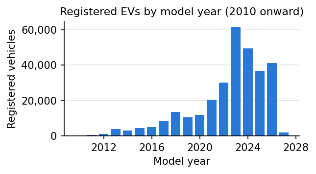

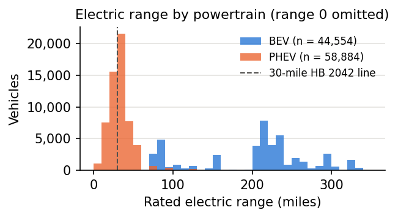
:::

Figure 1 is a bar chart because model year is discrete and ordered; it omits 30 pre-2010 vehicles. Because the fleet is so recent, the RQ1 counts measure recent adoption. Figure 2 overlays the range histograms of the two powertrains after removing zero ranges, which would otherwise hide everything behind a 200,000-vehicle spike. Zeros are 81.8% of BEVs, so range is unknown for most battery cars. The 30-mile line falls inside the PHEV distribution, so RQ4's threshold mostly separates PHEVs.

### 6.2 D2 — Title and registration activity

**Size.** 1,964,093 rows, one per event (a vehicle appears many times), by 14 analysed columns (13 plus ZIP), from 6 January 2010 to 31 October 2026. **Missing data.** 632 of 27,497,302 cells (0.002%): County, Postal Code and ZIP in 195 rows (dropped from ZIP joins), Electric Range in 46 (unknown) and State in 1. **Variables of interest.** Transaction Type and New or Used Vehicle (RQ2), Year and County (RQ3), Sale Price, Electric Range, Model Year and Odometer Reading (RQ4), and DOL Vehicle ID (key to D1).

| Variable | n | mean | std | min | Q1 | median | Q3 | max |
|---|---|---|---|---|---|---|---|---|
| Electric Range | 1,964,047 | 60.9 | 89.5 | 0 | 0 | 17 | 84 | 337 |
| Model Year | 1,964,093 | 2020.4 | 3.8 | 1993 | 2018 | 2021 | 2023 | 2027 |
| Sale Price, used, > $0 | 150,300 | 30,223 | 62,672 | 1 | 16,700 | 25,995 | 37,991 | 12,312,016 |

: Table 3. Quantitative variables in D2 (the cleaned RQ4 sample is in Table 8).

| Transaction Type | New | Used | Total |
|---|---|---|---|
| Registration Renewal | 0 | 963,861 | 963,861 |
| Original Registration | 0 | 405,599 | 405,599 |
| Original Title | 314,331 | 82,481 | 396,812 |
| Transfer Title | 0 | 101,351 | 101,351 |
| Registration at time of Transfer | 0 | 96,470 | 96,470 |

: Table 4. Every transaction type by condition (New 314,331, Used 1,649,762). The HB 2042 range flag is True on 1,749,291 rows and False on 214,802; 99.6% of rows have a Washington address.

Table 4 matters most: "New" appears only on original titles, and half the file is renewals. Only 9.1% of used rows carry a price, because renewals and registrations never do; 81.8% of the 183,832 used title events record one. Yearly event counts are 110 (2010), 2,488, 4,953, 12,842, 17,821, 23,283, 31,286, 43,186, 62,090, 77,358, 88,755, 123,050, 165,827, 249,581, 327,213, 381,463 (2025) and 352,787 (2026, January–October).

::: figrow
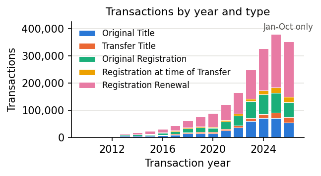

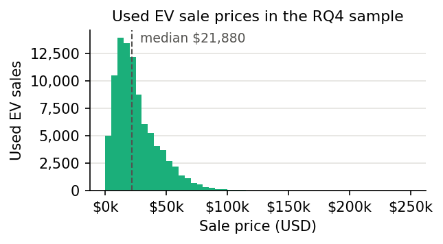
:::

Figure 3 stacks yearly counts by transaction type, showing volume and composition at once; across the file, 49.1% of events are renewals, and the 2026 bar covers ten months. Figure 4 histograms the cleaned RQ4 prices. The long right tail (skewness 1.75) is why RQ4 models log price and uses a rank-based test.

::: figrow
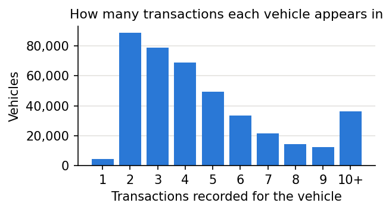

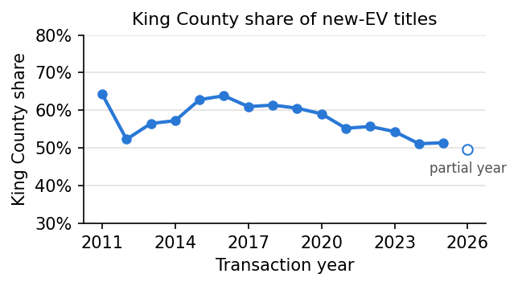
:::

Figure 5 counts events per DOL Vehicle ID (4.81 on average). Counting rows would therefore count renewals and resales, which is why RQ2 and RQ4 deduplicate by vehicle. Figure 6 shows the RQ3 inputs: new-vehicle original titles with a Washington address, by year. A line suits one proportion over time; the hollow point marks partial 2026 (49.7%). Statewide new titles grew from 1,182 in 2011 to 57,659 in 2024, then fell 8.0% to 53,061 in 2025 (three-year trailing mean +24.6%). All 39 counties appear, with these 2010–2025 totals: King 152,897 · Snohomish 33,650 · Pierce 22,543 · Clark 15,427 · Thurston 9,025 · Kitsap 8,598 · Spokane 7,021 · Whatcom 5,497 · Benton 3,053 · Skagit 2,710 · Island 2,537 · Chelan 1,439 · Yakima 1,381 · Clallam 1,372 · Cowlitz 1,298 · Jefferson 1,134 · Mason 1,099 · Lewis 1,001 · San Juan 916 · Franklin 826 · Grant 813 · Grays Harbor 789 · Kittitas 768 · Walla Walla 621 · Douglas 521 · Whitman 469 · Klickitat 397 · Okanogan 329 · Stevens 291 · Pacific 278 · Skamania 243 · Asotin 100 · Pend Oreille 87 · Adams 80 · Wahkiakum 58 · Lincoln 55 · Ferry 40 · Columbia 27 · Garfield 1.

### 6.3 D3 — IRS ZIP-level income

**Size.** Washington contributes 3,000 rows. Dropping the 12 pseudo-ZIP rows leaves 2,988 rows — 498 ZIPs × 6 AGI brackets (agi_stub 1–6, 498 rows each) — by 7 analysed columns (6 plus ZIP). **Missing data.** None: `isna().sum().sum()` is 0 of 20,916 cells. Every ZIP has at least 100 returns. **Variables of interest.** N1 (returns) and A00100 (AGI, thousands of USD), summed over brackets into RETURNS and AVG_AGI = AGI ÷ returns, the RQ1 predictor and the basis of the quartiles.

| Variable (n = 498 ZIPs) | mean | std | min | Q1 | median | Q3 | max |
|---|---|---|---|---|---|---|---|
| RETURNS | 7,340 | 7,736 | 100 | 800 | 3,985 | 12,668 | 37,870 |
| AVG_AGI (thousands USD) | 96.7 | 68.6 | 33.4 | 67.3 | 80.5 | 103.3 | 1,191.7 |

: Table 5. D3 after collapsing brackets to one row per ZIP.

The quartiles are return-weighted: ZIPs are sorted by income and split where a quarter, half and three quarters of all returns have been counted. Q2, Q3 and Q4 begin at $77.2k, $93.2k and $128.2k, each quartile holds about 912,000–918,000 returns, and the ZIP counts are 211, 119, 92 and 76.

::: figrow
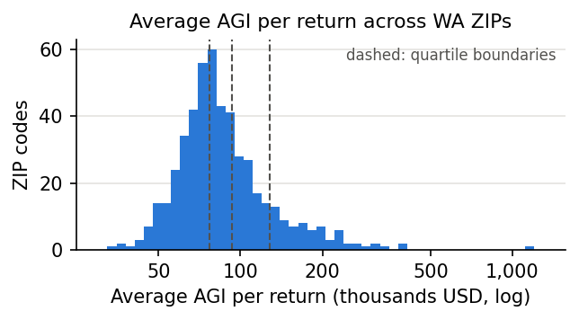

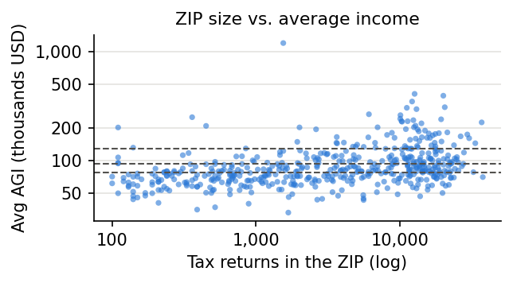
:::

Figure 7 uses a log axis so the bulk of ZIPs ($50k–$150k) and the tail share a readable scale; dashed lines are the quartile boundaries. Figure 8 scatters ZIP size against income on log–log axes, because both span more than an order of magnitude. Size and income are positively related (Spearman ρ = 0.425). Many small, mostly rural ZIPs therefore fill the bottom quartile (211 ZIPs), while fewer, larger suburban ZIPs fill the top (76). Weighting by returns keeps each quartile at the same number of filers despite this imbalance.

### 6.4 Join D1 × D3 — the income gradient (RQ1)

**Relationship and coverage.** D1's Postal Code and D3's zipcode are the same geography. D1 is aggregated to one row per ZIP first, so the merge is one-to-one, which the code checks before merging by requiring the ZIP key to be unique on both sides. 491 of D1's 1,198 ZIPs match (41.0%), but they hold **99.5% of vehicles**. Of the 707 unmatched ZIPs, 612 are out of state (774 vehicles) and 95 are Washington ZIPs that the IRS folds into `99999` (727 vehicles). **Size and missingness.** The joined frame is 491 rows × 9 columns with no missing cells.

| Variable (n = 491 ZIPs) | mean | std | min | Q1 | median | Q3 | max |
|---|---|---|---|---|---|---|---|
| EVs per ZIP | 616.5 | 920.6 | 1 | 31 | 206 | 884.5 | 7,221 |
| EVs per 1,000 returns | 70.5 | 148.3 | 1.5 | 26.9 | 48.4 | 86.5 | 3,127.8 |
| AVG_AGI (thousands USD) | 97.2 | 68.9 | 33.4 | 67.5 | 80.9 | 103.6 | 1,191.7 |
| BEV share | 0.764 | 0.127 | 0 | 0.733 | 0.780 | 0.822 | 1 |

: Table 6. The joined D1 × D3 frame.

The gradient is strong. Spearman's ρ is **0.775**, and the median density rises monotonically across quartiles — **27.3 → 50.2 → 84.6 → 143.7** EVs per 1,000 returns, a 5.3× spread. The maximum, 3,127.8, is ZIP 98134 (Seattle's industrial SoDo district): 1,126 EVs against 360 returns, almost certainly fleet registrations. Dropping it moves ρ only to 0.774. As a supplement, the BEV share also rises with income, from 75.6% in Q1 to 83.2% in Q4 (Cramér's V = 0.068, minimum expected count 6,487). Income predicts *how many* EVs a ZIP has far better than *which kind*.

::: figrow
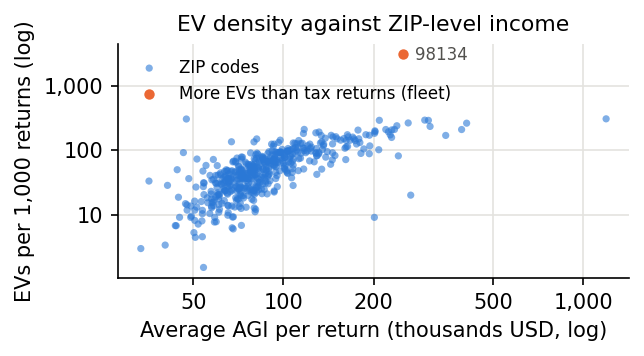

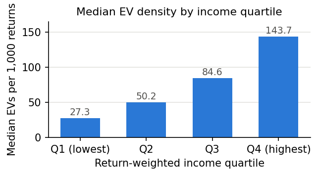
:::

Figure 9 scatters the two quantitative variables on log axes. This spreads the dense middle and keeps 98134 from flattening the plot, and the relationship it shows is monotone, as a rank correlation assumes. Figure 10 shows quartile medians as bars, which suit four ordered groups; medians are unaffected by 98134. The growing steps are the quantitative core of RQ1.

### 6.5 Join D2 × D3 — the secondary market (RQ2)

**Relationship and coverage.** D2 joins D3 through Postal Code: title events are counted per ZIP and condition, then merged one-to-one. 498,163 acquisitions of 398,897 vehicles fall in 1,297 ZIPs. 495 of these ZIPs match (38.2%), and they hold **99.5% of acquisitions**. **Size and missingness.** 495 rows × 8 columns, no missing cells. Per ZIP, acquisitions range from 1 to 12,831 (median 306). The used share ranges from 0 to 1 (median 0.435, mean 0.446, std 0.139).

| Quartile | New | Used | Used share |
|---|---|---|---|
| Q1 (lowest) | 31,072 | 26,707 | **46.2%** |
| Q2 | 49,519 | 36,371 | **42.4%** |
| Q3 | 72,698 | 48,143 | **39.8%** |
| Q4 (highest) | 160,231 | 70,998 | **30.7%** |

: Table 7. New and used acquisitions by income quartile.

Used EVs **do** reach lower-income ZIPs disproportionately. The used share falls from 46.2% in the poorest quartile to 30.7% in the richest (χ² = 7,518.9, p < 10^−300^, Cramér's V = 0.123), and across ZIPs it falls with income (Spearman ρ = −0.538). With one acquisition per vehicle and condition, the pattern holds (39.3% → 27.0%, V = 0.102).

::: figrow
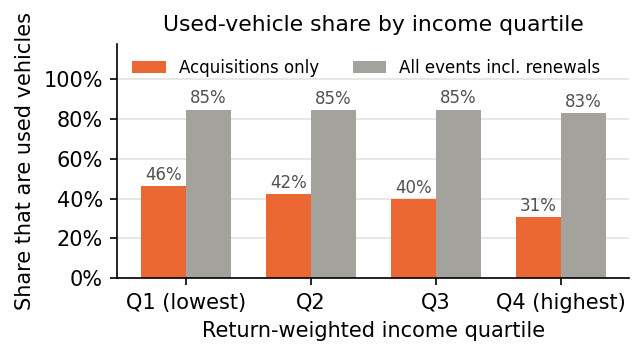

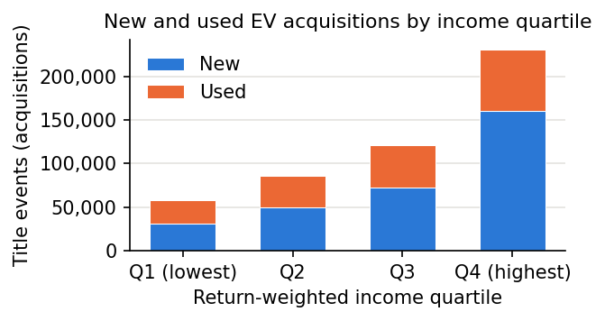
:::

Figure 11 shows the two ways of counting side by side, which is why RQ2 counts acquisitions: renewals push every quartile to about 84% used. Figure 12 stacks new and used counts — the stacked bar the proposal promised — so the reader sees the volume behind each share and that no cell of the chi-square table is sparse.

### 6.6 Join D2 × D1 — vehicles and their sales (RQ4)

**Relationship and coverage.** Both files carry DOL Vehicle ID; VIN (1-10) is a shared prefix and cannot serve as a key. Each registered vehicle can have many sales, so the join is many-to-one. All 304,258 D1 vehicles appear among D2's 407,930 IDs; the other 25.4% have left the fleet. D1 adds what D2 lacks: a label saying whether a range was researched, and whether the vehicle is still registered.

**The joined RQ4 frame** has 92,726 used sales of 72,825 vehicles, by 21 columns, after excluding 56,564 in-band sales with unknown range. 68.8% of sales match a current D1 vehicle (72.1% below 30 miles, 67.9% above), and where both files give a range they agree in 100% of rows. The 57,815 missing cells are D1's two columns for vehicles that have left the fleet; they are informative and are not imputed.

| RQ4 sample (n = 92,726) | mean | std | min | Q1 | median | Q3 | max |
|---|---|---|---|---|---|---|---|
| Price, all | 26,099 | 18,687 | 1,000 | 12,995 | 21,880 | 34,980 | 249,680 |
| Price, range < 30 (n = 20,830) | 29,317 | 17,851 | 1,000 | 16,900 | 27,406 | 37,499 | 242,899 |
| Price, range ≥ 30 (n = 71,896) | 25,167 | 18,820 | 1,000 | 11,991 | 20,000 | 33,000 | 249,680 |
| Electric Range | 114.5 | 92.2 | 1 | 32 | 84 | 210 | 337 |
| Model Year | 2017.7 | 3.2 | 1998 | 2015 | 2018 | 2020 | 2026 |
| Odometer Reading | 40,971 | 32,335 | 0 | 18,969 | 33,060 | 55,251 | 992,418 |

: Table 8. The RQ4 sample (Transfer Title 55,874, Original Title 36,852); 92,508 rows have a usable odometer (1–500,000 miles).

::: figrow
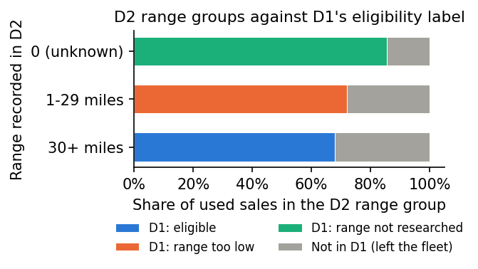

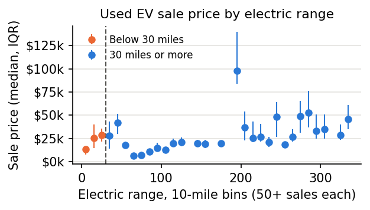
:::

Figure 13 is a 100% stacked bar of D1's label within each D2 range group; grey marks vehicles that have left the fleet. It is the evidence for dropping zero ranges, and the main reason RQ4 needs the join. Figure 14 plots the median and interquartile range of price for each 10-mile bin with at least 50 sales. Prices climb from $13,400 (1–9 miles) to $28,995 (20–29 miles), collapse in the 60–89-mile bins where early short-range BEVs sit, and recover above 200 miles. Range is entangled with vehicle generation, so the RQ4 model must control for Model Year.

### 6.7 Null hypotheses and test assumptions (Result Validity)

RQ3 is descriptive and has no test. For the other questions:

- **RQ1.** *H₀:* no monotonic association between ZIP income and EV density (ρ = 0). *Test:* Spearman's ρ with a permutation p-value (10,000 within-region shuffles) and a bootstrap interval. *Assumptions:* (i) exchangeability under H₀ — density differs sharply between the 13 three-digit regions with at least 10 ZIPs: the share of a region's ZIPs above the statewide median density ranges from 2% (991) to 97% (981) (χ² = 198.7, p ≈ 6 × 10^−36^, minimum expected count 7). A statewide shuffle would therefore understate the null's spread, so shuffles stay within regions, and ρ is positive in each of the 13 (0.36 to 0.89). (ii) Monotone form — Figure 9. (iii) No single point drives ρ — 0.775 with 98134, 0.774 without.
- **RQ2.** *H₀:* the new/used mix of acquisitions is independent of income quartile. *Test:* χ² test of independence with Cramér's V. *Assumptions:* (i) expected counts ≥ 5 — the minimum is 21,238. (ii) Independent observations — 28,083 vehicles have more than one used acquisition, so the test is repeated with one per vehicle and condition (V = 0.102, same direction).
- **RQ4, distributions.** *H₀:* used-sale prices have the same distribution below and at or above 30 miles. *Test:* Mann-Whitney U. *Assumptions:* (i) independence — only each vehicle's latest sale is used: 72,825 sales, 17,051 below and 55,774 above. (ii) An ordinal outcome — price is continuous and right-skewed (1.75), which suits ranks.
- **RQ4, slopes.** *H₀:* the interaction of range and the 30-mile flag is zero. *Test:* OLS on log price with HC3 errors. *Assumptions:* (i) shape — raw price skewness is 148.6 (kurtosis 25,909), driven by typed dates; after the price rule it is 1.75, and −0.75 on the log scale. (ii) Constant variance — the spread of log price differs between the two sides (standard deviation 0.67 below 30 miles, 0.81 above), so the model will use robust (HC3) errors, and its residuals will be checked once it is fitted in the final analysis.

## 7. Challenge Goals Update

**Multiple Datasets** keeps its scope and is now stronger. RQ1 needs D1 × D3, RQ2 needs D2 × D3, and RQ4 needs D2 × D1 to identify unresearched ranges. Before every merge the code checks that the join key is unique on the "one" side, so no merge can silently duplicate rows. Measured by rows, the joins cover 99.5% of vehicles (D1 × D3), 99.5% of acquisitions (D2 × D3), and all D1 vehicles and 68.8% of RQ4 sales (D2 × D1), as detailed in §6.4–6.6. **Result Validity** keeps its tests, with two EDA-driven updates: RQ1's permutation is stratified by region, and RQ4 uses log price with robust errors on one sale per vehicle.

## 8. Work Plan Evaluation

Tasks 1–2 (downloaders, loaders, cleaning) were budgeted at 10 hours. The download took minutes and the first loaders about an hour, because missingness is tiny. Task 3 (EDA) was budgeted at 4 hours, and its first pass took about 2.5. The estimate missed because the proposal expected effort to go into missing values. The real work was in the data's *coding conventions* — renewals coded as used, zero meaning unresearched, IRS pseudo-ZIPs, dates typed as prices. An audit of the first draft against the raw files uncovered these, changed RQ2's measure and RQ4's sample, and added time beyond the 2.5 hours. Tasks 4–6 (tests, models, final report) were budgeted at 16 hours; I now estimate **20**, because the permutation is stratified, the RQ4 sample needs one sale per vehicle, and the OLS needs robust errors. The project runs on Python 3.9.6 instead of the planned 3.11, which all pinned packages support. The planned `notes/eda.md` decision log became §5 plus `notes/eda_stats.json`.

## 9. Testing

The dangerous failures here are silent. A join that matches the wrong rows, or a count that includes renewals, still runs and still draws a plausible figure. So every test asserts an exact value; all 31 run with `pytest tests/`.

- **Unit tests** (28, in `tests/test_data.py` and `tests/test_eda_report.py`) use hand-built frames with known answers. They cover ZIP normalisation (leading zeros, `00000`, `99999`, float input), duplicate-vehicle detection, the return threshold, weighted quartiles, date parsing, the exclusion of renewals, every RQ4 rule (29/30 miles, typed dates, zero range), range groups, RQ3 county counts and growth rates, the seven-number summary, and Cramér's V on a table with χ² = 20 by hand.
- **Independent cross-check** (3, in `tests/test_cross_check.py`). The per-ZIP aggregates of all three files are recounted with Python's `csv` module and plain dictionaries instead of pandas, and must match exactly. The RQ1 quartile medians and RQ2 used shares are rebuilt from those raw counts and compared with `notes/eda_stats.json`, and a 1,000-row sample of each file is loaded.
- **Guards** make a renamed column (`usecols`), a duplicated vehicle, or a duplicated join key before a merge raise an error. Every figure was checked visually, and `flake8` passes.

The tests were checked against real failures. The audit of the first draft found a pseudo-ZIP counted as a place, renewals counted as acquisitions, and a helper that split missing values under two labels. Each now has a test that fails on the old behaviour.

## 10. Collaboration

Resources consulted beyond course staff: the Washington DOL open-data documentation for field definitions; the IRS Statistics of Income documentation for A00100, agi_stub and the `99999` code; and the `pandas` and `scipy` reference documentation. I used an AI coding assistant to scaffold the loader modules, to audit the code and report against the raw data, and to help edit prose. All analysis decisions and interpretation are my responsibility, and every number in this report is reproducible from the code in the repository.
