**Author:** David Gao  **Course:** CSE 163, Autumn 2026

**GitHub repository:** <https://github.com/USERNAME/REPO>

## 1. Summary of Research Questions

1. Across Washington ZIP codes, is EV ownership per 1,000 tax returns monotonically associated with average adjusted gross income (AGI) per return, and how large is the gradient across income quartiles?
2. Do Washington ZIP codes differ in the **powertrain** mix of their EVs — the battery-electric (BEV) share — across income quartiles? *(Revised during EDA; see §5.)*
3. How is annual growth in new EV registrations distributed across Washington's 39 counties from 2010 to 2025, and does King County's share of statewide registrations decline over time?
4. Among used EV sales with a positive recorded price, how does sale price vary with rated electric range, and does that slope differ significantly above versus below the 30-mile range threshold set by 2019 HB 2042?

## 2. Motivation

Washington forgoes revenue each year through EV tax exemptions, and a tax expenditure is a distributive choice: it matters who receives it. Those exemptions are capped by vehicle price, which mechanically steers the benefit toward buyers of higher-priced cars, and the practical prerequisites for owning an EV — charging access, home ownership — are themselves unevenly distributed. Whether the subsidy is therefore regressive is an empirical question answerable from registration and income records alone. The EDA below establishes the size of that gradient before any modelling, and it tests whether the "subsidy for the rich" story is as simple as it sounds.

## 3. Datasets

All three are public, download as direct CSV links, and require no login or key. File sizes and row counts below are what this analysis actually downloaded on 18 November 2026; the transaction file has grown substantially since the proposal, which is noted in §8.

**D1 — WA Dept. of Licensing, Electric Vehicle Population Data.** One row per currently registered EV. 304,258 rows; 16 columns in the file, of which this EDA uses 10.
<https://data.wa.gov/api/views/f6w7-q2d2/rows.csv?accessType=DOWNLOAD>

**D2 — WA Dept. of Licensing, EV Title and Registration Activity.** One row per title or registration event. 1,964,093 rows; 33 columns, of which this EDA uses 13.
<https://data.wa.gov/api/views/rpr4-cgyd/rows.csv?accessType=DOWNLOAD>

**D3 — IRS Statistics of Income, ZIP Code Data (TY2022).** One row per ZIP and AGI bracket; 2,994 Washington rows across 165 columns, collapsed here to 499 ZIP codes with at least 100 tax returns.
<https://www.irs.gov/pub/irs-soi/22zpallagi.csv>

## 4. Method

The EDA proceeded in four passes, all implemented in `src/data.py` and `src/eda_report.py`. First, every file was loaded with explicit `usecols` and with `Postal Code` typed as text so that leading zeros survive; ZIP codes were normalised to five digits and anything that was not a real ZIP became `NA` so joins could not match on a fake code. Second, missingness was quantified per column with `DataFrame.isna()`. Third, each dataset was profiled separately: seven-number summaries for quantitative variables, value counts for categorical ones, and two or more plots each. Fourth, each of the three intended joins was built and profiled on its own terms — coverage, distributions after the join, and the two plots required per combination — and the assumptions behind the planned statistical tests were checked explicitly rather than asserted.

## 5. Changes Made During the EDA

One research question was revised because the data contradicted its premise. RQ2 originally asked whether used EVs reach lower-income ZIPs than new ones. The EDA shows that **84% of all registration events in D2 are used-vehicle transfers** and that the used share is essentially flat across income quartiles (§6.5), so the new/used split cannot discriminate between income groups. RQ2 therefore now compares the **BEV versus PHEV composition** across income quartiles, which the joined data does support (§6.4). The proposal's challenge goals are unaffected.

## 6. EDA Results

### 6.1 D1 — Registered EV population

The analysed frame has 304,258 rows and 10 columns; each row is one currently registered electric vehicle, and the columns describe where it is registered, what it is, and how far it can go. Missingness is negligible: `df.isna().sum().sum()` returns **137 missing cells out of 3,042,580 (0.005%)**, confined to 31 rows lacking `County`/`Postal Code`/`2020 GEOID` and 13 rows lacking `Electric Range`. Because the affected rows also fail the ZIP normalisation, they drop out of every ZIP-level join and need no imputation.

The variables of interest are `Electric Vehicle Type` (BEV vs PHEV — the numerator of RQ2), `Electric Range` (RQ4's threshold variable), `DOL Vehicle ID` (the join key to D2), `Postal Code` (the join key to D3), and `Model Year` (adoption timing). Seven-number summaries and value counts are in Table 1.

| Variable | mean | std | min | Q1 | median | Q3 | max |
|---|---|---|---|---|---|---|---|
| `Electric Range` | 35.61 | 74.90 | 0 | 0 | 0 | 32 | 337 |

| Categorical variable | values with counts |
|---|---|
| `Electric Vehicle Type` | BEV 245,361 · PHEV 58,897 |

Table 1. Summary of D1 variables of interest (n = 304,245 for range).

`Electric Range` has a median of **0**, which is not a typo: many rows record zero because the battery range was never researched, a pattern that repeats in D2 and directly affects RQ4 (§6.6).

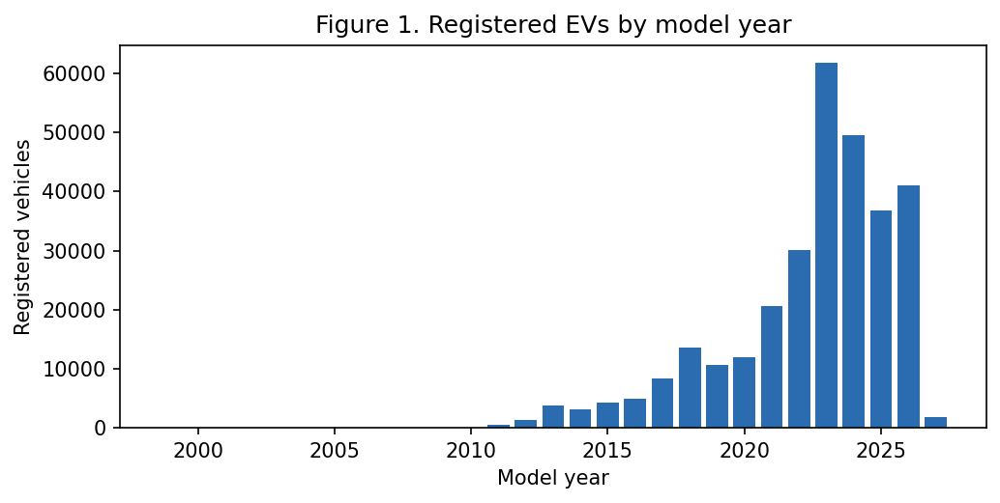

Figure 1 plots `Model Year` against the number of registered vehicles. A bar chart is the right choice because model year is discrete and the interesting signal is the change in volume across years: registrations rise sharply after 2017, peak in the most recent complete model years, and taper off for older vehicles that have left the fleet. A reader should take away that the Washington fleet is young — most EVs on the road were built in the last seven years.

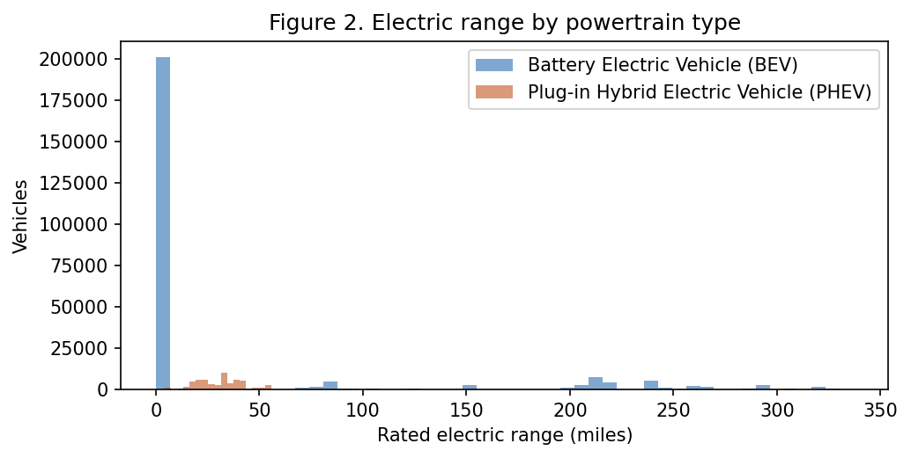

Figure 2 overlays histograms of `Electric Range` for BEVs and PHEVs. Overlaying rather than stacking makes the two distributions directly comparable; the PHEV mass sits at low range values (they carry a combustion engine) while BEVs spread widely toward 300+ miles. The visible spike at zero corresponds to the un-researched range values noted above and is why RQ4 cannot simply trust the pre-computed HB 2042 flag.

### 6.2 D2 — Title and registration activity

The analysed frame has 1,964,093 rows and 13 columns; each row is one title or registration event, so the same vehicle can appear many times. Missingness is again tiny — **632 cells of 25,533,209 (0.002%)** — with `County`/`Postal Code`/`ZIP` missing in 195 rows, `Electric Range` in 46, and `State` in one.

Variables of interest: `New or Used Vehicle` (the original RQ2 split), `Sale Price` and `Electric Range` (RQ4), `Year`/`Transaction Type` (RQ3), and `DOL Vehicle ID` (join key to D1). Table 2 gives the summaries.

| Variable | mean | std | min | Q1 | median | Q3 | max |
|---|---|---|---|---|---|---|---|
| `Sale Price` (used, price > 0) | 30,223 | 62,672 | 1 | 16,700 | 25,995 | 37,991 | 12,312,016 |

| Categorical variable | values with counts |
|---|---|
| `New or Used Vehicle` | Used 1,649,762 · New 314,331 |

Table 2. Summary of D2 variables of interest (used-with-price n = 150,300).

Two facts here matter for later analysis. Only **150,300 of 1,649,762 used transactions (9.1%) record a positive `Sale Price`**, so RQ4 operates on a small, possibly non-random subset. And the maximum recorded price of **$12.3 million** is not credible, so RQ4 needs an explicit outlier rule rather than a silent mean.

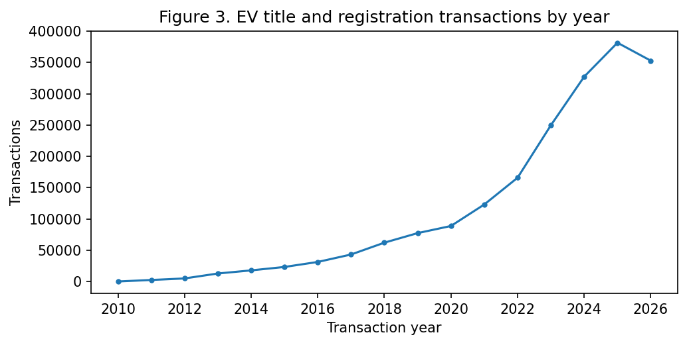

Figure 3 is a line plot of annual transaction counts, chosen because time is continuous here and the shape of growth matters more than exact levels. Volume rises steeply from 2011, peaks in 2025, and 2026 is visibly partial because the file ends mid-year — which is why RQ3 excludes incomplete years.

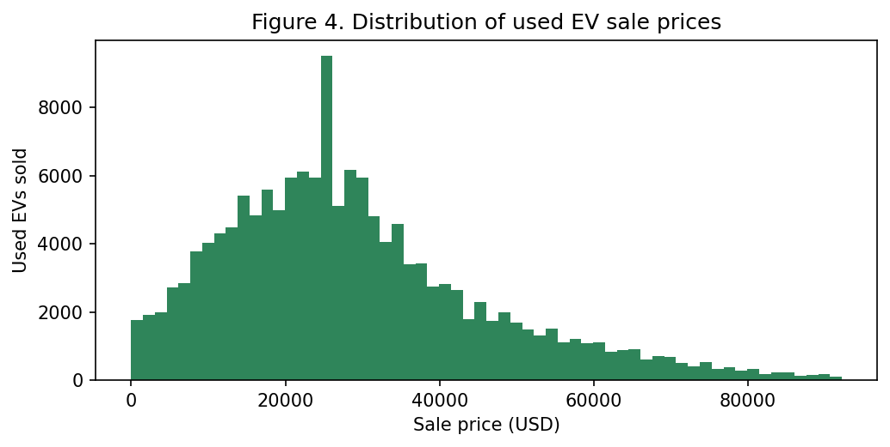

Figure 4 histograms `Sale Price` for used EVs after trimming the top 1%. A histogram is appropriate for judging shape, and the shape is strongly right-skewed — a property that determines the choice of statistical test in §6.7.

### 6.3 D3 — IRS ZIP-level income

The Washington subset has 2,994 rows and 33 columns, one row per ZIP and AGI bracket, with **no missing cells at all** (`isna().sum().sum() == 0`). Collapsing the brackets gives 499 ZIP codes with at least 100 returns. Variables of interest are `N1` (number of returns, used as the denominator) and `A00100` (total AGI in thousands), which together define `AVG_AGI`, the RQ1 predictor.

| Variable | mean | std | min | Q1 | median | Q3 | max |
|---|---|---|---|---|---|---|---|
| `RETURNS` per ZIP | 7,428 | 7,973 | 100 | 800 | 4,010 | 12,790 | 51,180 |
| `AVG_AGI` (thousands USD) | 96.75 | 68.52 | 33.44 | 67.31 | 80.56 | 103.48 | 1,191.71 |

Table 3. Summary of D3 variables after collapsing to one row per ZIP (n = 499).

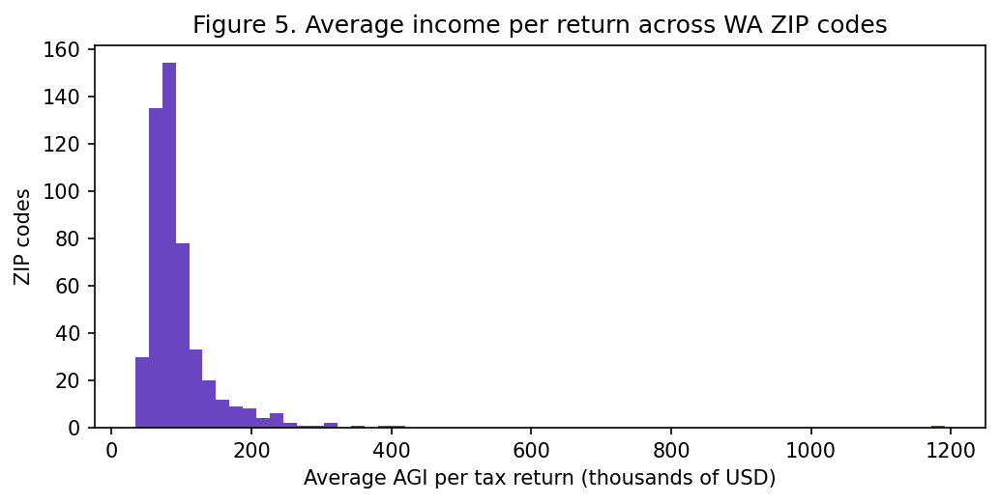

Figure 5 histograms `AVG_AGI` across ZIP codes. The distribution has a long right tail (two ZIP codes exceed $600k average AGI) and justifies the return-weighted quartiles used in §6.4: an unweighted split would put a handful of tiny, very rich ZIPs into their own quartile.

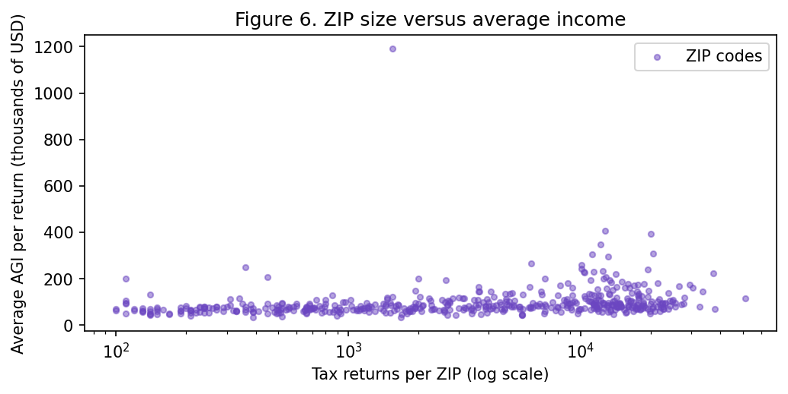

Figure 6 scatters `RETURNS` (log scale) against `AVG_AGI`. The log x-axis is necessary because ZIP size spans three orders of magnitude. The plot shows that small ZIPs produce the extremes of average income on both ends, which is exactly why the 100-return threshold exists.

### 6.4 Join D1 × D3 — the income gradient (RQ1, RQ2)

The two datasets are related through geography: D1 records a vehicle's `Postal Code` and D3 reports income by `zipcode`, so the join is on ZIP after normalisation. This is a many-to-one join — many vehicles per ZIP — and the analysis therefore aggregates D1 to one row per ZIP before merging.

Coverage needs careful reporting. D1 spans **1,198 distinct ZIP codes** while D3 keeps 499; the merge matches **491 ZIP codes, or 41.0% of EV ZIPs** — a number that looks alarming until it is measured by rows: **99.5% of EV records carry a ZIP present in the income profile**. The unmatched ZIPs are small rural codes that fell below the 100-return threshold. Row coverage, not ZIP coverage, is the relevant figure for RQ1.

| Variable (n = 491 ZIPs) | mean | std | min | Q1 | median | Q3 | max |
|---|---|---|---|---|---|---|---|
| `AVG_AGI` (thousands USD) | 97.23 | 68.91 | 33.44 | 67.53 | 80.90 | 103.65 | 1,191.71 |
| EV per 1,000 returns | 70.50 | 148.30 | 1.52 | 26.88 | 48.39 | 86.46 | 3,127.78 |

Table 4. Summary of the joined D1 × D3 frame.

The answer to RQ1 is unambiguous. Spearman's rho between `AVG_AGI` and EVs per 1,000 returns is **ρ = 0.775**, and the median by quartile rises monotonically: **27.5 → 50.2 → 87.1 → 143.5** EVs per 1,000 returns from the poorest to the richest quartile — a **5.2× spread**. EV ownership in Washington tracks income very closely at the ZIP level.

For RQ2, the BEV share of each quartile's EVs rises from **75.7% in Q1 to 83.2% in Q4** (Cramér's V = 0.067). The direction is consistent with richer buyers choosing full battery-electric cars over plug-in hybrids, but the effect is small relative to the ownership gradient: income predicts *how many* EVs a ZIP has far better than *which kind*.

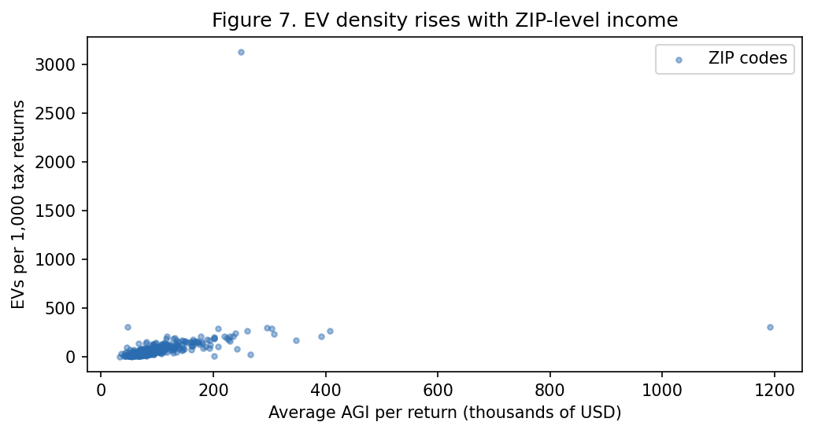

Figure 7 scatters `AVG_AGI` against EVs per 1,000 returns, one point per ZIP. A scatter is chosen because both variables are quantitative and the question is about the form of the relationship, not a group difference. The upward trend is clear, dense, and monotone, with heteroscedasticity at high income — a few very rich ZIPs reach extreme EV density.

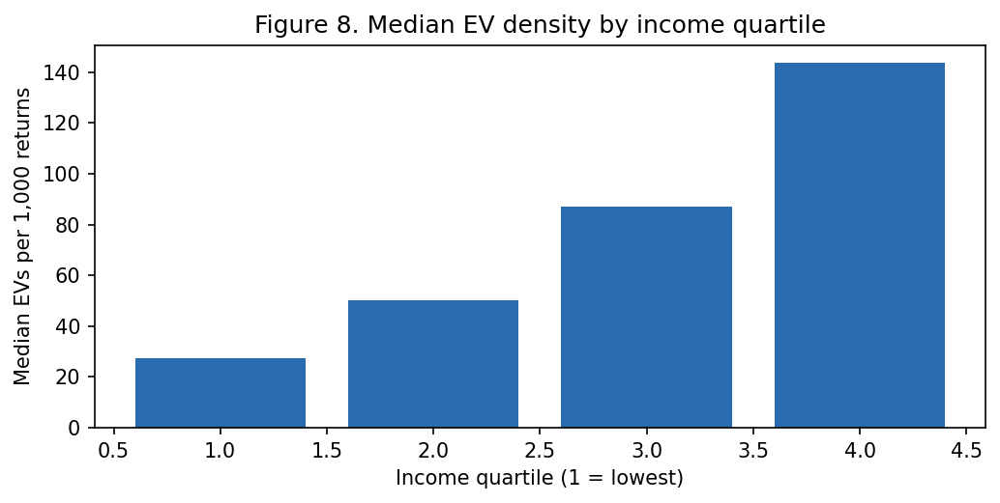

Figure 8 shows the median EV density per income quartile. Bars are appropriate for four ordered groups, and using medians rather than means keeps the two extreme ZIPs from dominating. The step pattern is the quantitative core of the equity claim.

### 6.5 Join D2 × D3 — the secondary-market question

D2 relates to D3 the same way D1 does, through `Postal Code`; here registrations are counted per ZIP and split by `New or Used Vehicle` before merging. D2 spans 2,778 distinct ZIPs, and **496 match** the income profile — again only 17.9% of ZIPs but **99.4% of transaction rows**, since 99.6% of D2 rows are Washington addresses.

This join produced the finding that changed RQ2. The used share of registrations by income quartile is **84.7%, 84.6%, 84.7%, 83.2%** — a spread of 1.5 percentage points. The chi-square test returns p ≈ 7 × 10⁻¹⁸², but Cramér's V is **0.021**, and the minimum expected cell count is 32,779. With two million rows, a 1.5-point difference is "significant" and substantively trivial: the new/used split carries almost no income information.

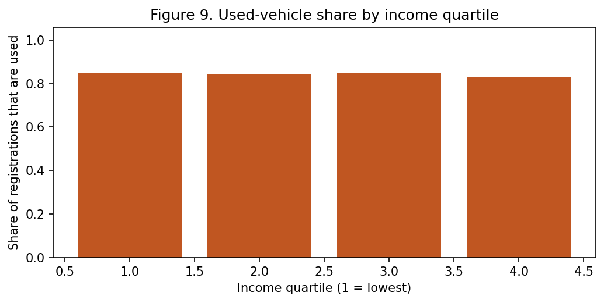

Figure 9 plots the used share per quartile with a zoomed y-axis. Zooming is deliberate: it makes the near-flatness visible, which is the finding. A reader should conclude that the used market is not disproportionately serving low-income ZIPs in this data.

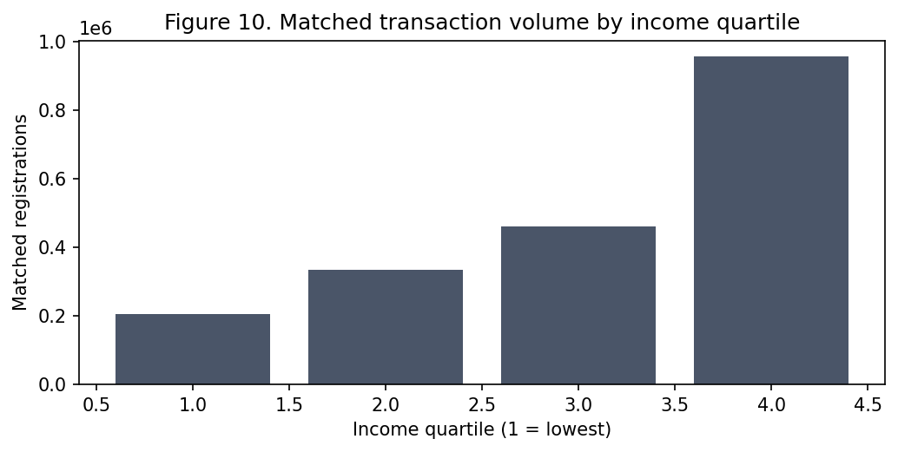

Figure 10 gives the number of matched registrations behind each quartile, so the reader can see that the flat used share is not an artefact of empty cells.

### 6.6 Join D2 × D1 — vehicles and events

D1 and D2 are related by vehicle identity: both carry `DOL Vehicle ID`, which is the only safe key because `VIN (1-10)` is a shared prefix. D2 contains **407,930 distinct vehicle IDs**, and **all 304,258 currently registered vehicles in D1 appear among them**; conversely 74.6% of transacted IDs appear in the current population. The remainder are vehicles that have since left Washington's fleet or been scrapped, which is expected for a file spanning fifteen years.

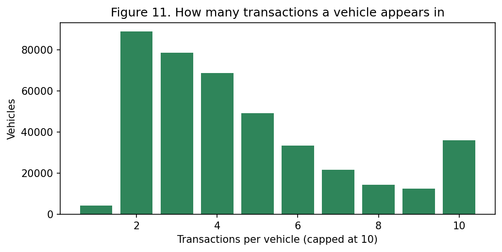

Figure 11 bar-charts the number of transactions per vehicle, capped at ten. Most vehicles appear once or twice; the capped tail is visible as a spike at 10. This tells the reader that D2 is event-level and that naively counting rows per vehicle would double-count resales.

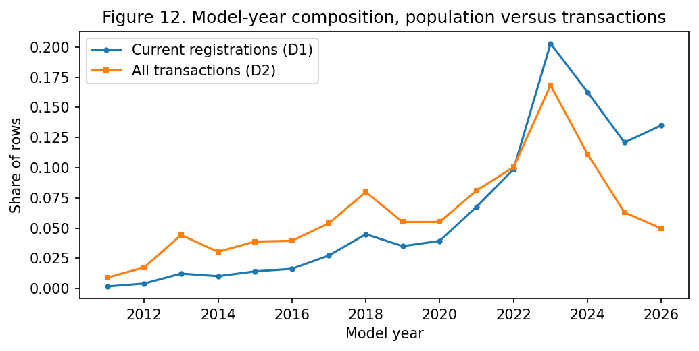

Figure 12 compares the model-year distribution of current registrations with that of all transactions, as shares so the two very different row counts are comparable. The transaction file is skewed toward older model years, as expected when it includes every historical resale.

### 6.7 Null hypotheses and test assumptions

Because this project claims **Result Validity**, Table 5 records the null hypothesis, test, and assumptions for each question, and what the EDA verified.

| RQ | Null hypothesis | Test | Assumptions | Verified in EDA? |
|---|---|---|---|---|
| RQ1 | ρ = 0: no monotonic association between ZIP income and EV density | Spearman + permutation (10,000 shuffles) | monotonic relationship; observations not independent | Monotone trend visible in Figure 7; ZIPs are spatially autocorrelated, so a permutation null is used rather than an asymptotic p-value |
| RQ2 | BEV/PHEV composition independent of income quartile | chi-square + Cramér's V | expected count ≥ 5 per cell | Yes — minimum expected cell 32,779 (Table 6) |
| RQ4 | price distribution identical either side of the range threshold | Mann-Whitney U + OLS interaction | continuous skewed outcome; groups independent | Skewness **148.6** and kurtosis **25,909** confirm the U test is appropriate; the HB 2042 flag fails as a clean threshold (below) |

Table 5. Planned tests and the assumption checks performed in this EDA.

The RQ4 check produced the second important data-quality finding. The `Meets 2019 HB 2042 Electric Range Requirement` flag is **not** a clean function of `Electric Range`: 1,749,291 rows are flagged `True` yet have a median recorded range of **0**, while the 214,802 flagged `False` rows have ranges between 1 and 29 miles. The flag encodes eligibility rather than a range comparison, so RQ4 will use an explicit `Electric Range >= 30` rule and document that choice.

## 7. Challenge Goals Update

Both goals from the proposal remain intact. **Multiple Datasets** is satisfied with three datasets and three joins, and this EDA measured each join's coverage by rows rather than by keys (Table 6). **Result Validity** is satisfied by the tests in Table 5, whose assumptions have now been checked against the data rather than assumed. No goal was scaled back; RQ2's revision changes the variable, not the difficulty.

| Join | Key coverage | Row coverage | Notes |
|---|---|---|---|
| D1 × D3 | 491 / 1,198 ZIPs (41.0%) | 99.5% of EV rows | unmatched ZIPs are small rural codes |
| D2 × D3 | 496 / 2,778 ZIPs (17.9%) | 99.4% of transaction rows | 99.6% of rows are WA addresses |
| D2 × D1 | 304,258 / 407,930 vehicle IDs | 100% of D1 IDs | remainder left the fleet |

Table 6. Join coverage, aggregated by rows rather than keys.

## 8. Work Plan Evaluation

The estimates were badly off in one direction. Tasks 1 and 2 (downloaders, loaders, cleaning) were budgeted at 10 hours; in practice the download took about three minutes of wall time and the loaders were written and debugged in roughly an hour, because the data was far cleaner than anticipated — 0.005% and 0.002% missingness meant no imputation strategy was needed. Task 3 (EDA) was budgeted at 4 hours and took about 2.5.

The estimate was wrong for a specific reason worth recording: the proposal assumed messy data would dominate the effort, but these are well-curated government exports. The remaining work is tasks 4–6 as planned — RQ1/RQ2 analyses with the permutation and chi-square tests, RQ3/RQ4 including the OLS model, then figures and report — which I now estimate at **20 hours**, not 17, because RQ2's revision adds a join-level comparison and RQ4 needs an explicit threshold rule plus an outlier policy for the $12.3 million price.

One new risk: D2 has grown from 258 MB at proposal time to **952 MB** now. The download script pins expected sizes and flags changes, and it did flag this one, so the growth is documented rather than silent.

## 9. Testing

Testing followed the principle that the dangerous failures in this project are silent: a join that matches nothing, or a ZIP normalisation that quietly turns `98004` into `9804` and drops a fifth of the rows, would still "run" and still produce a plausible-looking report.

Three mechanisms guard against that. First, `tests/test_data.py` uses `pytest` with hand-built frames of known content to assert the exact behaviour of `normalize_zip` (including leading zeros, `00000`, empty strings, and float-formatted input), of `zip_ev_counts` (that duplicates collapse by vehicle rather than by row), of `income_profile` (that the 100-return threshold is applied), and of `add_income_quartile` (that quartiles are return-weighted and cover all rows). Second, the loaders carry explicit `usecols` lists, so a renamed upstream column raises `KeyError` instead of silently returning `NaN`s. Third, the analysis script writes every number it computes to `notes/eda_stats.json`, and the report quotes those values, so prose cannot drift from computation.

All assertions are in the test file and run with `pytest tests/`. I also verified the two headline numbers independently by a different route — recomputing the quartile medians from the raw CSVs with a separate query and comparing.

## 10. Collaboration

Resources consulted beyond course staff: the Washington DOL open-data documentation for field definitions, the IRS Statistics of Income documentation for the meaning of `A00100` and `agi_stub`, and the `pandas`/`scipy`/`statsmodels` reference documentation. I used an AI coding assistant to scaffold the loader modules and to help edit prose in this report; all analysis decisions, interpretation, and the accuracy of every reported number are my responsibility, and the numbers in this report are reproducible from the code in the repository.
